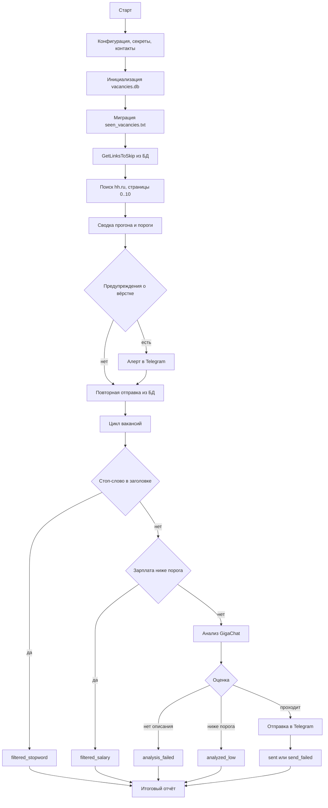
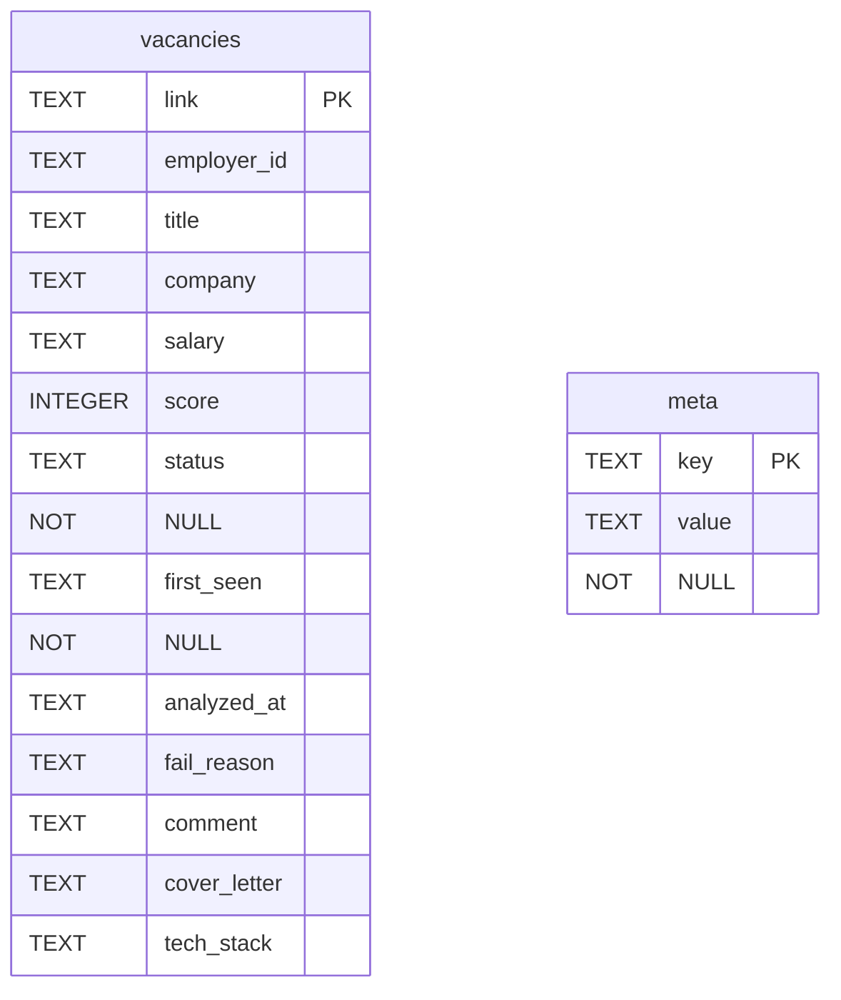

# Текущая архитектура

## Назначение

Этот документ описывает то, что код делает сейчас: поток одного прогона, модули, статусы и схему БД. Расхождения с принятыми решениями собраны в отдельном разделе [«Известные расхождения с решениями»](#известные-расхождения-с-решениями). Почему решено так — в [docs/adr/](adr/).

## Поток одного прогона

1. Старт; Ctrl+C: первый — остановка после текущей вакансии, второй — жёсткий выход — [Program.cs:82-96](../src/AiRecruiter/Program.cs#L82-L96).
2. Конфигурация: `appsettings.json` (optional) + переменные окружения — [Program.cs:100-104](../src/AiRecruiter/Program.cs#L100-L104).
3. Секреты `GIGACHAT_AUTH_KEY` / `TELEGRAM_BOT_TOKEN` / `TELEGRAM_CHAT_ID` — [Program.cs:106-164](../src/AiRecruiter/Program.cs#L106-L164).
4. Контакты `Contacts:Fio/Tg/Phone/Email` обязательны, иначе выход — [Program.cs:112-144](../src/AiRecruiter/Program.cs#L112-L144).
5. `resume.txt` / `profile.md` / `candidate_summary.md` — при отсутствии заглушки — [Program.cs:146-148](../src/AiRecruiter/Program.cs#L146-L148).
6. `workFormat`: area `113` → REMOTE, area `4` → любой, иначе REMOTE — [Program.cs:176-188](../src/AiRecruiter/Program.cs#L176-L188).
7. Инициализация хранилища `vacancies.db` — [Program.cs:191-192](../src/AiRecruiter/Program.cs#L191-L192).
8. Миграция `seen_vacancies.txt` → vacancies со статусом `seen`, файл переименовывается — [Program.cs:194-220](../src/AiRecruiter/Program.cs#L194-L220).
9. Порог `Analyzer:MinScore` (по умолчанию 7) — [Program.cs:222](../src/AiRecruiter/Program.cs#L222).
10. `GetLinksToSkip()` — уже обработанные ссылки из БД — [Program.cs:224](../src/AiRecruiter/Program.cs#L224).
11. Поиск hh.ru: страницы 0..10 — [Program.cs:226](../src/AiRecruiter/Program.cs#L226).
12. Сводка прогона парсера и лог — [Program.cs:230-231](../src/AiRecruiter/Program.cs#L230-L231).
13. Пороги `HhParser:Thresholds:*`, `Filters:MinSalary`, `Filters:ExcludeTitleWords` — [Program.cs:234-241](../src/AiRecruiter/Program.cs#L234-L241).
14. Предупреждения о вёрстке hh.ru — [Program.cs:245-293](../src/AiRecruiter/Program.cs#L245-L293).
15. Создание анализатора — [Program.cs:295](../src/AiRecruiter/Program.cs#L295).
16. Создание notifier — [Program.cs:297](../src/AiRecruiter/Program.cs#L297).
17. Алерт о смене вёрстки в Telegram, если есть предупреждения — [Program.cs:299-304](../src/AiRecruiter/Program.cs#L299-L304).
18. Повторная отправка из сохранённого результата — до цикла вакансий — [Program.cs:307](../src/AiRecruiter/Program.cs#L307).
19. Цикл вакансий — [Program.cs:314-460](../src/AiRecruiter/Program.cs#L314-L460):
    1. пропуск уже виденных — [Program.cs:322](../src/AiRecruiter/Program.cs#L322);
    2. фильтр по стоп-словам в заголовке — [Program.cs:330](../src/AiRecruiter/Program.cs#L330);
    3. фильтр по зарплате — [Program.cs:352-353](../src/AiRecruiter/Program.cs#L352-L353);
    4. анализ GigaChat — [Program.cs:377](../src/AiRecruiter/Program.cs#L377);
    5. без описания → `analysis_failed` — [Program.cs:379-397](../src/AiRecruiter/Program.cs#L379-L397);
    6. оценка ниже порога → `analyzed_low`, в Telegram не отправляется — [Program.cs:398-419](../src/AiRecruiter/Program.cs#L398-L419);
    7. `analyzed_ok` → отправка в Telegram → `sent` / `send_failed` — [Program.cs:420-450](../src/AiRecruiter/Program.cs#L420-L450); метка 🔥/💭 — [Program.cs:440](../src/AiRecruiter/Program.cs#L440), запись статуса — [Program.cs:442](../src/AiRecruiter/Program.cs#L442).
20. Итог: отфильтровано по зарплате, распределение оценок, неудачи JSON — [Program.cs:462-474](../src/AiRecruiter/Program.cs#L462-L474).
21. Прогон ждёт Enter — [Program.cs:477](../src/AiRecruiter/Program.cs#L477).

## Модули

| Файл | Вход | Выход | Что пишет в БД |
|---|---|---|---|
| [Program.cs](../src/AiRecruiter/Program.cs) | конфигурация, секреты, контакты, входные файлы | запуск всех этапов, лог, итоговый отчёт | статусы всех вакансий: `seen`, `filtered_stopword`, `filtered_salary`, `analysis_failed`, `analyzed_low`, `analyzed_ok`, `sent`, `send_failed` |
| [HhParser.cs](../src/AiRecruiter/Parsers/HhParser.cs) | поисковый запрос, area, workFormat, skipLinks | список `Vacancy` + сводка прогона | нет |
| [JobAnalyzer.cs](../src/AiRecruiter/Analyzers/JobAnalyzer.cs) | вакансия, сводка кандидата, конфигурация GigaChat | `AnalysisResult` (score, comment, cover_letter) | нет |
| [TelegramNotifier.cs](../src/AiRecruiter/Notifiers/TelegramNotifier.cs) | вакансия, результат анализа, метка | сообщения Telegram | нет |
| [VacancyRepository.cs](../src/AiRecruiter/Storage/VacancyRepository.cs) | `VacancyRecord`, статусы | ссылки для пропуска, записи для повторной отправки, распределение оценок | запись и обновление строк `vacancies`, миграция колонок |
| [TitleFilter.cs](../src/AiRecruiter/Filters/TitleFilter.cs) | заголовок вакансии, стоп-слова | найденное стоп-слово или null | нет |
| [SalaryFilter.cs](../src/AiRecruiter/Filters/SalaryFilter.cs) | строка зарплаты, порог `Filters:MinSalary` | решение «пропустить» + нижняя граница | нет |
| [IntConfigReader.cs](../src/AiRecruiter/Configuration/IntConfigReader.cs) | конфигурация | целое число с значением по умолчанию | нет |
| [StringListConfigReader.cs](../src/AiRecruiter/Configuration/StringListConfigReader.cs) | конфигурация | список строк с значением по умолчанию | нет |
| [Logger.cs](../src/AiRecruiter/Logger.cs) | сообщения | `app.log` с ротацией 5 МБ | нет |
| [Vacancy.cs](../src/AiRecruiter/Models/Vacancy.cs) | — | поля вакансии, собранные парсером | нет |

## Диаграмма потока

## Статусы

| Статус | Где ставится | Что дальше |
|---|---|---|
| `seen` | миграция из файла — [Program.cs:205-215](../src/AiRecruiter/Program.cs#L205-L215) | попадает в `GetLinksToSkip`, не парсится заново |
| `filtered_stopword` | до GigaChat — [Program.cs:334-347](../src/AiRecruiter/Program.cs#L334-L347) | в `GetLinksToSkip`, не анализируется повторно |
| `filtered_salary` | до GigaChat — [Program.cs:356-369](../src/AiRecruiter/Program.cs#L356-L369) | в `GetLinksToSkip`, не анализируется повторно |
| `analysis_failed` | анализ без описания или провал — [Program.cs:382-395](../src/AiRecruiter/Program.cs#L382-L395) | не попадает в `GetLinksToSkip` — [VacancyRepository.cs:170-182](../src/AiRecruiter/Storage/VacancyRepository.cs#L170-L182), переанализируется при следующем появлении в выдаче |
| `analyzed_low` | оценка ниже порога — [Program.cs:402-415](../src/AiRecruiter/Program.cs#L402-L415) | в `GetLinksToSkip`, в Telegram не отправляется |
| `analyzed_ok` | оценка не ниже порога — [Program.cs:423-436](../src/AiRecruiter/Program.cs#L423-L436) | живёт только между `Upsert` и `SetStatus` в одной итерации цикла |
| `sent` / `send_failed` | результат отправки — [Program.cs:442](../src/AiRecruiter/Program.cs#L442) | обе попадают в повторную отправку из сохранённого результата — [VacancyRepository.cs:188-216](../src/AiRecruiter/Storage/VacancyRepository.cs#L188-L216) |

## Схема БД

Схема создаётся — [VacancyRepository.cs:50-70](../src/AiRecruiter/Storage/VacancyRepository.cs#L50-L70), отсутствующие колонки добавляются миграцией — [VacancyRepository.cs:72-92](../src/AiRecruiter/Storage/VacancyRepository.cs#L72-L92).

## Поля

| Поле | Тип | Смысл | Источник в коде |
|---|---|---|---|
| `employer_id` | TEXT NULL | идентификатор работодателя | всегда null — [Program.cs:207](../src/AiRecruiter/Program.cs#L207) |
| `score` | INTEGER NULL | оценка GigaChat 1..10 | [JobAnalyzer.cs:1004](../src/AiRecruiter/Analyzers/JobAnalyzer.cs#L1004) |
| `first_seen` | TEXT NOT NULL | время первой записи в БД | [Program.cs:328](../src/AiRecruiter/Program.cs#L328) |
| `analyzed_at` | TEXT NULL | время анализа или отправки | [Program.cs:391](../src/AiRecruiter/Program.cs#L391), [Program.cs:411](../src/AiRecruiter/Program.cs#L411), [Program.cs:432](../src/AiRecruiter/Program.cs#L432), [VacancyRepository.cs:138-140](../src/AiRecruiter/Storage/VacancyRepository.cs#L138-L140) |
| `tech_stack` | TEXT NULL | стек из описания вакансии | [HhParser.cs:664](../src/AiRecruiter/Parsers/HhParser.cs#L664) |

## Известные расхождения с решениями

- `employer_id` всегда null — [Program.cs:207](../src/AiRecruiter/Program.cs#L207), [Program.cs:336](../src/AiRecruiter/Program.cs#L336), [Program.cs:358](../src/AiRecruiter/Program.cs#L358), [Program.cs:384](../src/AiRecruiter/Program.cs#L384), [Program.cs:404](../src/AiRecruiter/Program.cs#L404), [Program.cs:425](../src/AiRecruiter/Program.cs#L425); решение 0002 — [employer_id из детальной страницы](adr/0002-employer-id-from-detail-page.md) — не реализовано.
- `seen_vacancies.txt` ещё мигрируется — [Program.cs:194-220](../src/AiRecruiter/Program.cs#L194-L220); лог [Program.cs:247](../src/AiRecruiter/Program.cs#L247) упоминает файл; удаление миграции запланировано на 3.2a.
- `analysis_abandoned` отсутствует; статусы — строковые литералы, не константы — [Program.cs:341](../src/AiRecruiter/Program.cs#L341), [Program.cs:363](../src/AiRecruiter/Program.cs#L363), [Program.cs:389](../src/AiRecruiter/Program.cs#L389), [Program.cs:409](../src/AiRecruiter/Program.cs#L409), [Program.cs:430](../src/AiRecruiter/Program.cs#L430), [Program.cs:442](../src/AiRecruiter/Program.cs#L442).
- Журнал `llm_calls`, таблица `candidate_profiles`, колонки `prompt_json` / `prompt_model` / `prompt_created_at` в БД нет — решение 3.2a пока не реализовано.
- Таблица `meta` создаётся — [VacancyRepository.cs:66-69](../src/AiRecruiter/Storage/VacancyRepository.cs#L66-L69) — но не используется.
- `GetScoreDistribution` — [VacancyRepository.cs:156](../src/AiRecruiter/Storage/VacancyRepository.cs#L156) — вызывается только из тестов; гистограмма в итоговом отчёте считается в памяти — [Program.cs:310](../src/AiRecruiter/Program.cs#L310), [Program.cs:467](../src/AiRecruiter/Program.cs#L467).
- [Program.cs:148](../src/AiRecruiter/Program.cs#L148) читает `candidate_summary.md` в неиспользуемую переменную; анализатор читает файл сам — [JobAnalyzer.cs:98](../src/AiRecruiter/Analyzers/JobAnalyzer.cs#L98).
- В БД нет `experience` / `employment` / `work_format` / `published_at`, хотя `Vacancy` их содержит — [Vacancy.cs](../src/AiRecruiter/Models/Vacancy.cs).
- Telegram не разбивает сообщения длиннее 4096 — [TelegramNotifier.cs:78-99](../src/AiRecruiter/Notifiers/TelegramNotifier.cs#L78-L99).
- `usage` / `completion_tokens` не читаются; критерий пересмотра `MaxTokens` (1200) не измеряется — [JobAnalyzer.cs:102](../src/AiRecruiter/Analyzers/JobAnalyzer.cs#L102).

## Правило обновления

- При изменении потока, схемы БД, статусов или модулей обновить этот документ в том же коммите и перепроверить все ссылки на строки.
- Новое архитектурное решение — новый ADR в [docs/adr/](adr/).
- Обязательное правило и чеклист перед коммитом — в разделе [«Документация»](../AGENTS.md#документация) файла [AGENTS.md](../AGENTS.md).
