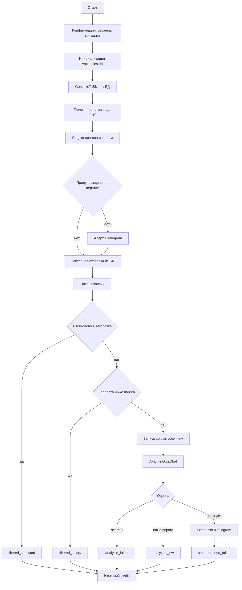
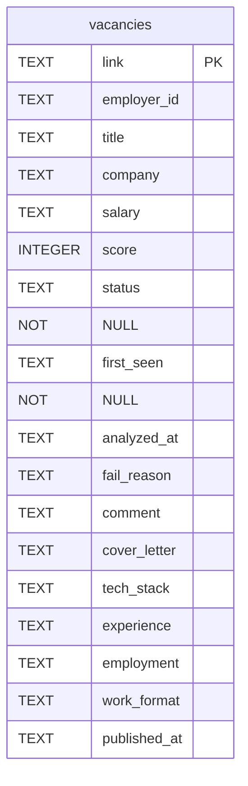

# Текущая архитектура

## Назначение

Этот документ описывает то, что код делает сейчас: поток одного прогона, модули,
статусы и схему БД. Расхождения с принятыми решениями собраны в отдельном
разделе
[«Известные расхождения с решениями»](#известные-расхождения-с-решениями).
Почему решено так — в [docs/adr/](adr/).

## Поток одного прогона

1. Старт; Ctrl+C: первый — остановка после текущей вакансии, второй — жёсткий
   выход — [Program.cs:83-96](../src/AiRecruiter/Program.cs#L83-L96).
2. Конфигурация: `appsettings.json` (optional) + переменные окружения —
   [Program.cs:101-105](../src/AiRecruiter/Program.cs#L101-L105).
3. Секреты `GIGACHAT_AUTH_KEY` / `TELEGRAM_BOT_TOKEN` / `TELEGRAM_CHAT_ID` —
   [Program.cs:107-164](../src/AiRecruiter/Program.cs#L107-L164).
4. Контакты `Contacts:Fio/Tg/Phone/Email` обязательны, иначе выход —
   [Program.cs:113-145](../src/AiRecruiter/Program.cs#L113-L145).
5. `resume.txt` / `profile.md` читаются, но в оценке не участвуют;
   `candidate_summary.md` — единственный источник, анализатор читает его сам —
   [JobAnalyzer.cs:98](../src/AiRecruiter/Analyzers/JobAnalyzer.cs#L98). При
   отсутствии сводки — пустая сводка.
6. `workFormat`: area `113` → REMOTE, area `4` → любой, иначе REMOTE —
   [Program.cs:177-189](../src/AiRecruiter/Program.cs#L177-L189).
7. Инициализация хранилища `vacancies.db` —
   [Program.cs:192-193](../src/AiRecruiter/Program.cs#L192-L193).
8. Порог `Analyzer:MinScore` (по умолчанию 3) —
   [Program.cs:195](../src/AiRecruiter/Program.cs#L195).
9. `GetLinksToSkip()` — уже обработанные ссылки из БД —
   [Program.cs:197](../src/AiRecruiter/Program.cs#L197).
10. Поиск hh.ru: страницы 0..10 —
    [Program.cs:199](../src/AiRecruiter/Program.cs#L199).
11. Сводка прогона парсера и лог —
    [Program.cs:203-204](../src/AiRecruiter/Program.cs#L203-L204).
12. Пороги `HhParser:Thresholds:*`, `Filters:MinSalary`,
    `Filters:ExcludeTitleWords` —
    [Program.cs:207-213](../src/AiRecruiter/Program.cs#L207-L213).
13. Предупреждения о вёрстке hh.ru —
    [Program.cs:216-267](../src/AiRecruiter/Program.cs#L216-L267).
14. Создание анализатора — [Program.cs:268](../src/AiRecruiter/Program.cs#L268).
15. Создание notifier — [Program.cs:270](../src/AiRecruiter/Program.cs#L270).
16. Алерт о смене вёрстки в Telegram, если есть предупреждения —
    [Program.cs:272-277](../src/AiRecruiter/Program.cs#L272-L277).
17. Повторная отправка из сохранённого результата — до цикла вакансий —
    [Program.cs:280](../src/AiRecruiter/Program.cs#L280).
18. Цикл вакансий —
    [Program.cs:287-436](../src/AiRecruiter/Program.cs#L287-L436):
    1. пропуск уже виденных —
       [Program.cs:295](../src/AiRecruiter/Program.cs#L295);
    2. фильтр по стоп-словам в заголовке —
       [Program.cs:303](../src/AiRecruiter/Program.cs#L303);
    3. фильтр по зарплате —
       [Program.cs:329-350](../src/AiRecruiter/Program.cs#L329-L350);
    4. запись со статусом `new` до анализа —
       [Program.cs:356-376](../src/AiRecruiter/Program.cs#L356-L376);
    5. анализ GigaChat — [Program.cs:379](../src/AiRecruiter/Program.cs#L379);
    6. без описания → `analysis_failed` —
       [Program.cs:384-402](../src/AiRecruiter/Program.cs#L384-L402);
    7. оценка ниже порога → `analyzed_low`, в Telegram не отправляется —
       [Program.cs:404-423](../src/AiRecruiter/Program.cs#L404-L423);
    8. `analyzed_ok` → отправка в Telegram → `sent` / `send_failed` —
       [Program.cs:425-455](../src/AiRecruiter/Program.cs#L425-L455); метка
       🔥/💭 — [Program.cs:454](../src/AiRecruiter/Program.cs#L454),
       запись статуса — [Program.cs:456](../src/AiRecruiter/Program.cs#L456).
19. Итог: отфильтровано по зарплате, распределение оценок, неудачи JSON —
    [Program.cs:476-482](../src/AiRecruiter/Program.cs#L476-L482).
20. Прогон ждёт Enter — [Program.cs:490](../src/AiRecruiter/Program.cs#L490).

## Модули

| Файл | Вход | Выход | Что пишет в БД |
|---|---|---|---|
| [Program.cs](../src/AiRecruiter/Program.cs) | конфигурация, секреты, контакты, входные файлы | запуск всех этапов, лог, итоговый отчёт | статусы всех вакансий: `new`, `filtered_stopword`, `filtered_salary`, `analysis_failed`, `analyzed_low`, `analyzed_ok`, `sent`, `send_failed` |
| [HhParser.cs](../src/AiRecruiter/Parsers/HhParser.cs) | поисковый запрос, area, workFormat, skipLinks | список `Vacancy` + сводка прогона | нет |
| [JobAnalyzer.cs](../src/AiRecruiter/Analyzers/JobAnalyzer.cs) | вакансия, сводка кандидата, конфигурация GigaChat | `AnalysisResult` (score, comment, cover_letter) | нет |
| [TelegramNotifier.cs](../src/AiRecruiter/Notifiers/TelegramNotifier.cs) | вакансия, результат анализа, метка | сообщения Telegram | нет |
| [VacancyRepository.cs](../src/AiRecruiter/Storage/VacancyRepository.cs) | `VacancyRecord`, статусы | ссылки для пропуска, записи для повторной отправки, распределение оценок | запись и обновление строк `vacancies`, миграция колонок |
| [TitleFilter.cs](../src/AiRecruiter/Filters/TitleFilter.cs) | заголовок вакансии, стоп-слова | найденное стоп-слово или null | нет |
| [SalaryFilter.cs](../src/AiRecruiter/Filters/SalaryFilter.cs) | строка зарплаты, порог `Filters:MinSalary` | решение «пропустить» + нижняя граница | нет |
| [IntConfigReader.cs](../src/AiRecruiter/Configuration/IntConfigReader.cs) | конфигурация | целое число с значением по умолчанию | нет |
| [StringListConfigReader.cs](../src/AiRecruiter/Configuration/StringListConfigReader.cs) | конфигурация | список строк с значением по умолчанию | нет |
| [Logger.cs](../src/AiRecruiter/Logger.cs) | сообщения | `app.log` с ротацией 5 МБ | нет |
| [Vacancy.cs](../src/AiRecruiter/Models/Vacancy.cs) | — | поля вакансии, собранные парсером | нет |

## Диаграмма потока

## Статусы

| Статус | Где ставится | Что дальше |
|---|---|---|
| `new` | до анализа — [Program.cs:356-376](../src/AiRecruiter/Program.cs#L356-L376) | не входит в `GetLinksToSkip`; обновляется ветками анализа; исключение оставляет `new` |
| `seen` | legacy-строки старых версий; миграция удалена | попадает в `GetLinksToSkip`, не парсится заново |
| `filtered_stopword` | до GigaChat — [Program.cs:311-324](../src/AiRecruiter/Program.cs#L311-L324) | в `GetLinksToSkip`, не анализируется повторно |
| `filtered_salary` | до GigaChat — [Program.cs:336-350](../src/AiRecruiter/Program.cs#L336-L350) | в `GetLinksToSkip`, не анализируется повторно |
| `analysis_failed` | анализ без описания или провал — [Program.cs:384-402](../src/AiRecruiter/Program.cs#L384-L402) | не попадает в `GetLinksToSkip` — [VacancyRepository.cs:194-206](../src/AiRecruiter/Storage/VacancyRepository.cs#L194-L206), переанализируется при следующем появлении в выдаче |
| `analyzed_low` | оценка ниже порога — [Program.cs:407-423](../src/AiRecruiter/Program.cs#L407-L423) | в `GetLinksToSkip`, в Telegram не отправляется |
| `analyzed_ok` | оценка не ниже порога — [Program.cs:428-441](../src/AiRecruiter/Program.cs#L428-L441) | живёт только между `Upsert` и `SetStatus` в одной итерации цикла |
| `sent` / `send_failed` | результат отправки — [Program.cs:456](../src/AiRecruiter/Program.cs#L456) | обе попадают в повторную отправку из сохранённого результата — [VacancyRepository.cs:212-240](../src/AiRecruiter/Storage/VacancyRepository.cs#L212-L240) |

## Схема БД

Схема создаётся —
[VacancyRepository.cs:51-76](../src/AiRecruiter/Storage/VacancyRepository.cs#L51-L76),
отсутствующие колонки добавляются миграцией —
[VacancyRepository.cs:81-110](../src/AiRecruiter/Storage/VacancyRepository.cs#L81-L110).

## Поля

| Поле | Тип | Смысл | Источник в коде |
|---|---|---|---|
| `employer_id` | TEXT NULL | идентификатор работодателя | из ссылки компании — [HhParser.cs:391](../src/AiRecruiter/Parsers/HhParser.cs#L391), извлечение — [HhParser.cs:1576-1607](../src/AiRecruiter/Parsers/HhParser.cs#L1576-L1607) |
| `score` | INTEGER NULL | оценка GigaChat 1..10 | [JobAnalyzer.cs:1004](../src/AiRecruiter/Analyzers/JobAnalyzer.cs#L1004) |
| `first_seen` | TEXT NOT NULL | время первой записи в БД | [Program.cs:297](../src/AiRecruiter/Program.cs#L297) |
| `analyzed_at` | TEXT NULL | время анализа или отправки | [Program.cs:390](../src/AiRecruiter/Program.cs#L390), [Program.cs:410](../src/AiRecruiter/Program.cs#L410), [Program.cs:431](../src/AiRecruiter/Program.cs#L431), [VacancyRepository.cs:161-164](../src/AiRecruiter/Storage/VacancyRepository.cs#L161-L164) |
| `tech_stack` | TEXT NULL | стек из описания вакансии | [HhParser.cs:665](../src/AiRecruiter/Parsers/HhParser.cs#L665) |
| `experience` | TEXT NULL | опыт по белому списку | [HhParser.cs:393-441](../src/AiRecruiter/Parsers/HhParser.cs#L393-L441) |
| `employment` | TEXT NULL | тип занятости | [HhParser.cs:501-523](../src/AiRecruiter/Parsers/HhParser.cs#L501-L523) |
| `work_format` | TEXT NULL | формат работы | [HhParser.cs:445-471](../src/AiRecruiter/Parsers/HhParser.cs#L445-L471) |
| `published_at` | TEXT NULL | дата публикации | [HhParser.cs:590](../src/AiRecruiter/Parsers/HhParser.cs#L590) |

## Известные расхождения с решениями

- `analysis_abandoned` отсутствует; статусы — строковые литералы, не константы —
  [Program.cs:314](../src/AiRecruiter/Program.cs#L314),
  [Program.cs:340](../src/AiRecruiter/Program.cs#L340),
  [Program.cs:365](../src/AiRecruiter/Program.cs#L365),
  [Program.cs:391](../src/AiRecruiter/Program.cs#L391),
  [Program.cs:415](../src/AiRecruiter/Program.cs#L415),
  [Program.cs:440](../src/AiRecruiter/Program.cs#L440); исправление —
  [roadmap 3.2a, шаг 6](roadmap.md).
- Журнала `llm_calls`, таблиц `prompt_versions` и `candidate_profiles` в БД нет
  — не реализовано; исправление — [roadmap 3.2a, шаг 7](roadmap.md).
- `GetScoreDistribution` —
  [VacancyRepository.cs:180](../src/AiRecruiter/Storage/VacancyRepository.cs#L180)
  — вызывается только из тестов; гистограмма в итоговом отчёте считается в
  памяти — [Program.cs:283](../src/AiRecruiter/Program.cs#L283),
  [Program.cs:482](../src/AiRecruiter/Program.cs#L482); исправление —
  технический бэклог после 3.6 в [roadmap](roadmap.md).
- [Program.cs:149](../src/AiRecruiter/Program.cs#L149) читает
  `candidate_summary.md` в неиспользуемую переменную; анализатор читает файл сам
  — [JobAnalyzer.cs:98](../src/AiRecruiter/Analyzers/JobAnalyzer.cs#L98);
  исправление — [roadmap 3.2a, шаг 5](roadmap.md).
- Исключение в цикле анализа оставляет строку `new` без `fail_reason` и без
  счётчика попыток — [Program.cs:470-473](../src/AiRecruiter/Program.cs#L470-L473):
  только лог; вакансия переанализируется при каждом появлении в выдаче без
  лимита; исправление — [roadmap 3.2a, шаг 6](roadmap.md).
- `GetLinksToSkip` — белый список статусов —
  [VacancyRepository.cs:198-203](../src/AiRecruiter/Storage/VacancyRepository.cs#L198-L203);
  решение — исключение `NOT IN ('new','analysis_failed')`; исправление —
  [roadmap 3.2a, шаг 6](roadmap.md).
- Telegram не разбивает сообщения длиннее 4096 —
  [TelegramNotifier.cs:78-99](../src/AiRecruiter/Notifiers/TelegramNotifier.cs#L78-L99);
  исправление — [roadmap 3.2a, шаг 8](roadmap.md).
- `usage` / `completion_tokens` не читаются, критерий пересмотра `MaxTokens`
  ([ADR-0004](adr/0004-max-tokens-1200.md)) не измеряется; код-дефолт — 800 —
  [JobAnalyzer.cs:102](../src/AiRecruiter/Analyzers/JobAnalyzer.cs#L102);
  исправление — калибровка 3.2 в [roadmap](roadmap.md).
- Контакты `Contacts:Fio/Tg/Phone/Email` читаются и проверяются на старте —
  [Program.cs:113-145](../src/AiRecruiter/Program.cs#L113-L145) — и собираются
  строкой — [Program.cs:145](../src/AiRecruiter/Program.cs#L145), но в промпт не
  попадают: поле только присваивается —
  [JobAnalyzer.cs:97](../src/AiRecruiter/Analyzers/JobAnalyzer.cs#L97). В анализ
  не входят; исправление — [roadmap 3.3](roadmap.md)
  ([ADR-0011](adr/0011-contacts-in-cover-letter.md)).

## Правило обновления

- При изменении потока, схемы БД, статусов или модулей обновить этот документ в
  том же коммите и перепроверить все ссылки на строки.
- Новое архитектурное решение — новый ADR в [docs/adr/](adr/).
- Обязательное правило и чеклист перед коммитом — в разделе
  [«Документация»](../AGENTS.md#документация) файла [AGENTS.md](../AGENTS.md).
