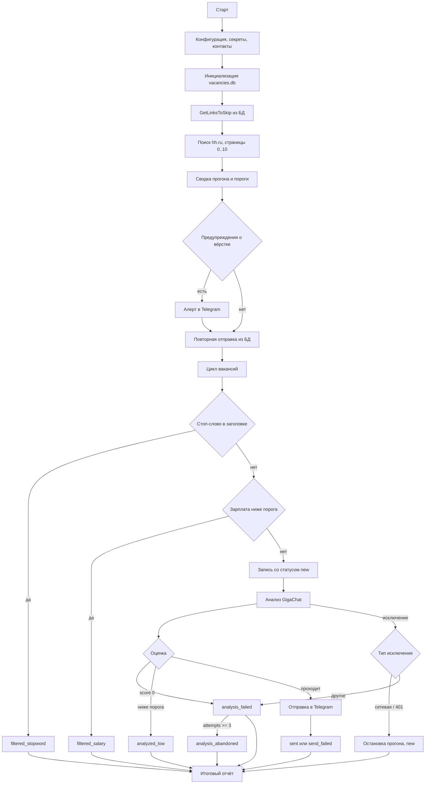
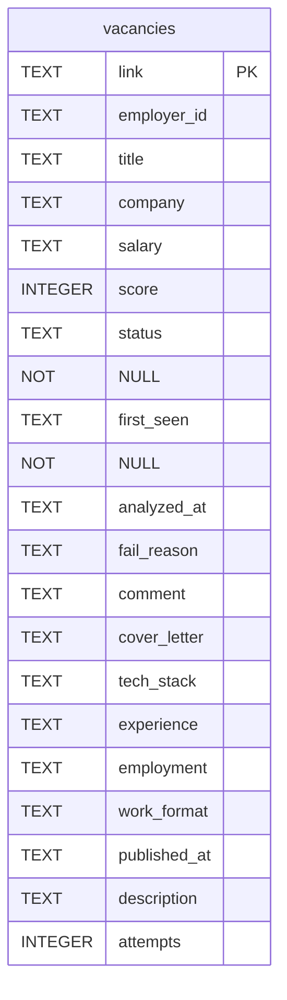

# Текущая архитектура

## Назначение

Этот документ описывает то, что код делает сейчас: поток одного прогона, модули,
статусы и схему БД. Расхождения с принятыми решениями собраны в отдельном
разделе
[«Известные расхождения с решениями»](#известные-расхождения-с-решениями).
Почему решено так — в [docs/adr/](adr/).

## Поток одного прогона

1. Старт; Ctrl+C: первый — остановка после текущей вакансии, второй — жёсткий
   выход — [Program.cs:83-97](../src/AiRecruiter/Program.cs#L83-L97).
2. Конфигурация: `appsettings.json` (optional) + переменные окружения —
   [Program.cs:101-105](../src/AiRecruiter/Program.cs#L101-L105).
3. Секреты `GIGACHAT_AUTH_KEY` / `TELEGRAM_BOT_TOKEN` / `TELEGRAM_CHAT_ID` —
   [Program.cs:107-174](../src/AiRecruiter/Program.cs#L107-L174).
4. Контакты `Contacts:Fio/Tg/Phone/Email` обязательны, иначе выход —
   [Program.cs:119-143](../src/AiRecruiter/Program.cs#L119-L143). В анализ они
   не передаются; появятся в письме в 3.3 —
   [ADR-0011](adr/0011-contacts-in-cover-letter.md).
5. `candidate_summary.md` читается один раз и обязательна: валидатор
   `CandidateSummaryValidator` останавливает прогон до парсинга, если файла нет
   или он пуст — [Program.cs:145-159](../src/AiRecruiter/Program.cs#L145-L159).
   `resume.txt` и `profile.md` не читаются.
6. `workFormat`: area `113` → REMOTE, area `4` → любой, иначе REMOTE —
   [Program.cs:183-195](../src/AiRecruiter/Program.cs#L183-L195).
7. Инициализация хранилища `vacancies.db` —
   [Program.cs:198-199](../src/AiRecruiter/Program.cs#L198-L199).
8. Порог `Analyzer:MinScore` (по умолчанию 3) —
   [Program.cs:201](../src/AiRecruiter/Program.cs#L201).
9. `GetLinksToSkip()` — уже обработанные ссылки из БД —
   [Program.cs:203](../src/AiRecruiter/Program.cs#L203).
10. Поиск hh.ru: страницы 0..10 —
    [Program.cs:205](../src/AiRecruiter/Program.cs#L205).
11. Сводка прогона парсера и лог —
    [Program.cs:209-210](../src/AiRecruiter/Program.cs#L209-L210).
12. Пороги `HhParser:Thresholds:*`, `Filters:MinSalary`,
    `Filters:ExcludeTitleWords` —
    [Program.cs:213-219](../src/AiRecruiter/Program.cs#L213-L219).
13. Предупреждения о вёрстке hh.ru —
    [Program.cs:222-271](../src/AiRecruiter/Program.cs#L222-L271).
14. Создание анализатора — [Program.cs:274](../src/AiRecruiter/Program.cs#L274);
    строка сводки уже проверена —
    [CandidateSummaryValidator.cs](../src/AiRecruiter/Analyzers/CandidateSummaryValidator.cs).
15. Создание notifier — [Program.cs:276](../src/AiRecruiter/Program.cs#L276).
16. Алерт о смене вёрстки в Telegram, если есть предупреждения —
    [Program.cs:278-283](../src/AiRecruiter/Program.cs#L278-L283).
17. Повторная отправка из сохранённого результата — до цикла вакансий —
    [Program.cs:286](../src/AiRecruiter/Program.cs#L286).
18. Цикл вакансий —
    [Program.cs:295-438](../src/AiRecruiter/Program.cs#L295-L438):
    1. пропуск уже виденных —
       [Program.cs:303](../src/AiRecruiter/Program.cs#L303);
    2. фильтр по стоп-словам в заголовке —
       [Program.cs:311](../src/AiRecruiter/Program.cs#L311);
    3. фильтр по зарплате —
       [Program.cs:323-334](../src/AiRecruiter/Program.cs#L323-L334);
    4. запись со статусом `new` до анализа —
       [Program.cs:338](../src/AiRecruiter/Program.cs#L338);
    5. анализ GigaChat — [Program.cs:342](../src/AiRecruiter/Program.cs#L342);
    6. без описания → `analysis_failed` —
       [Program.cs:344-361](../src/AiRecruiter/Program.cs#L344-L361); полное
       описание сохраняется в колонку `description` —
       [Program.cs:358](../src/AiRecruiter/Program.cs#L358);
    7. оценка ниже порога → `analyzed_low`, в Telegram не отправляется,
       `description` очищается —
       [Program.cs:362-378](../src/AiRecruiter/Program.cs#L362-L378);
    8. `analyzed_ok` → отправка в Telegram → `sent` / `send_failed`,
       `description` очищается —
       [Program.cs:380-405](../src/AiRecruiter/Program.cs#L380-L405); метка
       🔥/💭 — [Program.cs:394](../src/AiRecruiter/Program.cs#L394),
       запись статуса — [Program.cs:396](../src/AiRecruiter/Program.cs#L396);
    9. исключения: сетевые ошибки и `401` останавливают прогон
       ([ADR-0013](adr/0013-network-errors-stop-run.md)), строка остаётся
       `new`, попытка не списывается —
       [Program.cs:406-414](../src/AiRecruiter/Program.cs#L406-L414); Ctrl+C —
       [Program.cs:415-419](../src/AiRecruiter/Program.cs#L415-L419); остальные
       исключения → `analysis_failed` с причиной в `fail_reason`,
       `attempts + 1` —
       [Program.cs:420-437](../src/AiRecruiter/Program.cs#L420-L437).
19. Итог: остановка прогона, отфильтровано по зарплате, брошенные
    `analysis_abandoned` за прогон, распределение оценок, неудачи JSON —
    [Program.cs:440-467](../src/AiRecruiter/Program.cs#L440-L467); строки
    `[Abandoned]` — чистая функция [Program.cs:561-566](../src/AiRecruiter/Program.cs#L561-L566).
20. Прогон ждёт Enter — [Program.cs:470](../src/AiRecruiter/Program.cs#L470).

Правило блоков user-сообщения — [ADR-0012](adr/0012-full-description-prompt.md):
`Description` ≤ 6000 — один блок `ПОЛНОЕ ОПИСАНИЕ`; > 6000 при непустых секциях
— блоки секций; > 6000 без секций — первые 6000 символов; пустое описание при
непустых секциях — секции; нет ни описания, ни секций — GigaChat не вызывается
— [JobAnalyzer.cs:214-227](../src/AiRecruiter/Analyzers/JobAnalyzer.cs#L214-L227).

## Модули

| Файл | Вход | Выход | Что пишет в БД |
|---|---|---|---|
| [Program.cs](../src/AiRecruiter/Program.cs) | конфигурация, секреты, контакты, входные файлы | запуск всех этапов, лог, итоговый отчёт | статусы всех вакансий через `SaveFiltered` / `SaveAnalysis`: `new`, `filtered_stopword`, `filtered_salary`, `analysis_failed`, `analysis_abandoned`, `analyzed_low`, `analyzed_ok`, `sent`, `send_failed` |
| [HhParser.cs](../src/AiRecruiter/Parsers/HhParser.cs) | поисковый запрос, area, workFormat, skipLinks | список `Vacancy` + сводка прогона | нет |
| [JobAnalyzer.cs](../src/AiRecruiter/Analyzers/JobAnalyzer.cs) | вакансия, строка сводки кандидата, конфигурация GigaChat | `AnalysisResult` (score, comment, cover_letter, fail_reason) | нет |
| [TelegramNotifier.cs](../src/AiRecruiter/Notifiers/TelegramNotifier.cs) | вакансия, результат анализа, метка | сообщения Telegram | нет |
| [VacancyRepository.cs](../src/AiRecruiter/Storage/VacancyRepository.cs) | `VacancyRecord`, статусы | ссылки для пропуска, записи для повторной отправки, распределение оценок, итоговый статус и попытки `SaveAnalysis` | запись и обновление строк `vacancies`, миграция колонок, sweep `analysis_abandoned` |
| [VacancyStatus.cs](../src/AiRecruiter/Storage/VacancyStatus.cs) | — | константы статусов и полный список `All` | нет |
| [TitleFilter.cs](../src/AiRecruiter/Filters/TitleFilter.cs) | заголовок вакансии, стоп-слова | найденное стоп-слово или null | нет |
| [SalaryFilter.cs](../src/AiRecruiter/Filters/SalaryFilter.cs) | строка зарплаты, порог `Filters:MinSalary` | решение «пропустить» + нижняя граница | нет |
| [IntConfigReader.cs](../src/AiRecruiter/Configuration/IntConfigReader.cs) | конфигурация | целое число с значением по умолчанию | нет |
| [StringListConfigReader.cs](../src/AiRecruiter/Configuration/StringListConfigReader.cs) | конфигурация | список строк с значением по умолчанию | нет |
| [Logger.cs](../src/AiRecruiter/Logger.cs) | сообщения | `app.log` с ротацией 5 МБ | нет |
| [Vacancy.cs](../src/AiRecruiter/Models/Vacancy.cs) | — | поля вакансии, собранные парсером | нет |

## Диаграмма потока

## Статусы

| Статус | Где ставится | Что дальше |
|---|---|---|
| `new` | до анализа — [Program.cs:338](../src/AiRecruiter/Program.cs#L338) | не входит в `GetLinksToSkip`; обновляется ветками анализа; сетевая остановка оставляет `new` без списания попытки — [ADR-0013](adr/0013-network-errors-stop-run.md), [Program.cs:406-414](../src/AiRecruiter/Program.cs#L406-L414) |
| `seen` | legacy: только старые строки, новые с ним не создаются | попадает в `GetLinksToSkip`, не парсится заново |
| `filtered_stopword` | до GigaChat — [Program.cs:311-321](../src/AiRecruiter/Program.cs#L311-L321) | в `GetLinksToSkip`, не анализируется повторно |
| `filtered_salary` | до GigaChat — [Program.cs:323-334](../src/AiRecruiter/Program.cs#L323-L334) | в `GetLinksToSkip`, не анализируется повторно |
| `analysis_failed` | анализ без описания или провал — [Program.cs:344-361](../src/AiRecruiter/Program.cs#L344-L361), не-сетевое исключение — [Program.cs:420-437](../src/AiRecruiter/Program.cs#L420-L437) | не попадает в `GetLinksToSkip` — [VacancyRepository.cs:353-366](../src/AiRecruiter/Storage/VacancyRepository.cs#L353-L366); переанализируется при следующем появлении в выдаче; `attempts + 1`; после 3 неудач → `analysis_abandoned` |
| `analysis_abandoned` | 3 неудачных попытки: в `SaveAnalysis` — [VacancyRepository.cs:230-310](../src/AiRecruiter/Storage/VacancyRepository.cs#L230-L310) или sweep на старте — [VacancyRepository.cs:136-149](../src/AiRecruiter/Storage/VacancyRepository.cs#L136-L149) | терминальный: в `GetLinksToSkip`, в Telegram не уходит, попытки не списываются; возврат — SQL в [README.md](../README.md) |
| `analyzed_low` | оценка ниже порога — [Program.cs:362-378](../src/AiRecruiter/Program.cs#L362-L378) | в `GetLinksToSkip`, в Telegram не отправляется |
| `analyzed_ok` | оценка не ниже порога — [Program.cs:380-405](../src/AiRecruiter/Program.cs#L380-L405) | живёт только между `SaveAnalysis` и `SetStatus` в одной итерации цикла |
| `sent` / `send_failed` | результат отправки — [Program.cs:396](../src/AiRecruiter/Program.cs#L396) | обе попадают в повторную отправку из сохранённого результата — [VacancyRepository.cs:371-406](../src/AiRecruiter/Storage/VacancyRepository.cs#L371-L406) |

Строки статусов — константы [VacancyStatus.cs](../src/AiRecruiter/Storage/VacancyStatus.cs);
полный список — `VacancyStatus.All`; строковые литералы статусов в C# не
используются (исключение — legacy-миграция
[VacancyRepository.cs:127-133](../src/AiRecruiter/Storage/VacancyRepository.cs#L127-L133)).

## Схема БД

Схема создаётся —
[VacancyRepository.cs:57-84](../src/AiRecruiter/Storage/VacancyRepository.cs#L57-L84),
отсутствующие колонки добавляются миграцией —
[VacancyRepository.cs:90-121](../src/AiRecruiter/Storage/VacancyRepository.cs#L90-L121);
sweep `analysis_failed` с `attempts >= 3` → `analysis_abandoned` выполняется
после миграции в той же транзакции —
[VacancyRepository.cs:136-149](../src/AiRecruiter/Storage/VacancyRepository.cs#L136-L149).

## Поля

| Поле | Тип | Смысл | Источник в коде |
|---|---|---|---|
| `employer_id` | TEXT NULL | идентификатор работодателя | из ссылки компании — [HhParser.cs:391](../src/AiRecruiter/Parsers/HhParser.cs#L391), извлечение — [HhParser.cs:1576-1603](../src/AiRecruiter/Parsers/HhParser.cs#L1576-L1603) |
| `score` | INTEGER NULL | оценка GigaChat 1..10 | [JobAnalyzer.cs:881](../src/AiRecruiter/Analyzers/JobAnalyzer.cs#L881) |
| `first_seen` | TEXT NOT NULL | время первой записи в БД | [Program.cs:309](../src/AiRecruiter/Program.cs#L309) |
| `analyzed_at` | TEXT NULL | время анализа или отправки | [Program.cs:534](../src/AiRecruiter/Program.cs#L534), [VacancyRepository.cs:314-320](../src/AiRecruiter/Storage/VacancyRepository.cs#L314-L320) |
| `tech_stack` | TEXT NULL | стек из описания вакансии | [HhParser.cs:686](../src/AiRecruiter/Parsers/HhParser.cs#L686) |
| `experience` | TEXT NULL | опыт по белому списку | [HhParser.cs:393-443](../src/AiRecruiter/Parsers/HhParser.cs#L393-L443) |
| `employment` | TEXT NULL | тип занятости | [HhParser.cs:501-526](../src/AiRecruiter/Parsers/HhParser.cs#L501-L526) |
| `work_format` | TEXT NULL | формат работы | [HhParser.cs:445-471](../src/AiRecruiter/Parsers/HhParser.cs#L445-L471) |
| `published_at` | TEXT NULL | дата публикации | [HhParser.cs:590](../src/AiRecruiter/Parsers/HhParser.cs#L590) |
| `attempts` | INTEGER NOT NULL DEFAULT 0 | число неудачных попыток анализа; растёт только в `SaveAnalysis` одной транзакцией с результатом — [VacancyRepository.cs:230-310](../src/AiRecruiter/Storage/VacancyRepository.cs#L230-L310); `Upsert` и `SetStatus` не меняют; после 3 неудач — `analysis_abandoned` (лимит 3, константа — [VacancyRepository.cs:44](../src/AiRecruiter/Storage/VacancyRepository.cs#L44)) |
| `description` | TEXT NULL | полное описание, только для `analysis_failed` / `analysis_abandoned`; при успехе очищается | [Program.cs:358](../src/AiRecruiter/Program.cs#L358) — запись, [Program.cs:374](../src/AiRecruiter/Program.cs#L374), [Program.cs:390](../src/AiRecruiter/Program.cs#L390) — очистка; политика — [ADR-0012](adr/0012-full-description-prompt.md) |
| `fail_reason` | TEXT NULL | причина неудачи анализа, не длиннее 500 символов — [VacancyRepository.cs:41](../src/AiRecruiter/Storage/VacancyRepository.cs#L41) | `result.FailReason` — [JobAnalyzer.cs:27](../src/AiRecruiter/Analyzers/JobAnalyzer.cs#L27), обрезка — [VacancyRepository.cs:233-236](../src/AiRecruiter/Storage/VacancyRepository.cs#L233-L236) |

## Известные расхождения с решениями

- Журнала `llm_calls`, таблиц `prompt_versions` и `candidate_profiles` в БД нет
  — не реализовано; исправление — [roadmap 3.2a, шаг 7](roadmap.md).
- `GetScoreDistribution` —
  [VacancyRepository.cs:337](../src/AiRecruiter/Storage/VacancyRepository.cs#L337)
  — вызывается только из тестов; гистограмма в итоговом отчёте считается в
  памяти — [Program.cs:290](../src/AiRecruiter/Program.cs#L290),
  [Program.cs:461](../src/AiRecruiter/Program.cs#L461); исправление —
  технический бэклог после 3.6 в [roadmap](roadmap.md).
- Telegram не разбивает сообщения длиннее 4096 —
  [TelegramNotifier.cs:78-99](../src/AiRecruiter/Notifiers/TelegramNotifier.cs#L78-L99);
  исправление — [roadmap 3.2a, шаг 8](roadmap.md).
- `usage` / `completion_tokens` не читаются, критерий пересмотра `MaxTokens`
  ([ADR-0004](adr/0004-max-tokens-1200.md)) не измеряется; код-дефолт — 1200 —
  [JobAnalyzer.cs:102](../src/AiRecruiter/Analyzers/JobAnalyzer.cs#L102);
  исправление — калибровка 3.2 в [roadmap](roadmap.md).
- Контакты `Contacts:Fio/Tg/Phone/Email` проверяются на старте —
  [Program.cs:119-143](../src/AiRecruiter/Program.cs#L119-L143) — и в анализатор
  не передаются; письмо — [roadmap 3.3](roadmap.md)
  ([ADR-0011](adr/0011-contacts-in-cover-letter.md)).

## Правило обновления

- При изменении потока, схемы БД, статусов или модулей обновить этот документ в
  том же коммите и перепроверить все ссылки на строки.
- Новое архитектурное решение — новый ADR в [docs/adr/](adr/).
- Обязательное правило и чеклист перед коммитом — в разделе
  [«Документация»](../AGENTS.md#документация) файла [AGENTS.md](../AGENTS.md).
