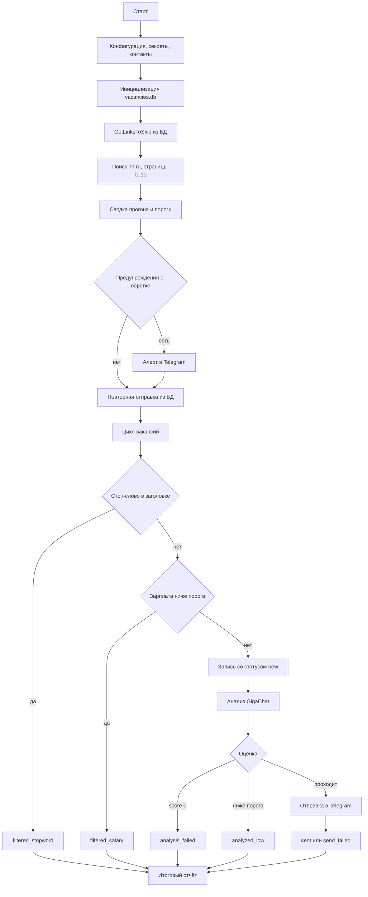
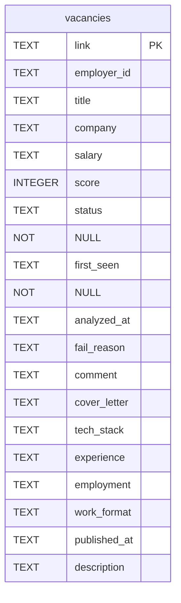

# Текущая архитектура

## Назначение

Этот документ описывает то, что код делает сейчас: поток одного прогона, модули,
статусы и схему БД. Расхождения с принятыми решениями собраны в отдельном
разделе
[«Известные расхождения с решениями»](#известные-расхождения-с-решениями).
Почему решено так — в [docs/adr/](adr/).

## Поток одного прогона

1. Старт; Ctrl+C: первый — остановка после текущей вакансии, второй — жёсткий
   выход — [Program.cs:83-97](../src/AiRecruiter/Program.cs#L83-L97).
2. Конфигурация: `appsettings.json` (optional) + переменные окружения —
   [Program.cs:101-105](../src/AiRecruiter/Program.cs#L101-L105).
3. Секреты `GIGACHAT_AUTH_KEY` / `TELEGRAM_BOT_TOKEN` / `TELEGRAM_CHAT_ID` —
   [Program.cs:107-174](../src/AiRecruiter/Program.cs#L107-L174).
4. Контакты `Contacts:Fio/Tg/Phone/Email` обязательны, иначе выход —
   [Program.cs:119-143](../src/AiRecruiter/Program.cs#L119-L143). В анализ они
   не передаются; появятся в письме в 3.3 —
   [ADR-0011](adr/0011-contacts-in-cover-letter.md).
5. `candidate_summary.md` читается один раз и обязательна: валидатор
   `CandidateSummaryValidator` останавливает прогон до парсинга, если файла нет
   или он пуст — [Program.cs:145-159](../src/AiRecruiter/Program.cs#L145-L159).
   `resume.txt` и `profile.md` не читаются.
6. `workFormat`: area `113` → REMOTE, area `4` → любой, иначе REMOTE —
   [Program.cs:183-195](../src/AiRecruiter/Program.cs#L183-L195).
7. Инициализация хранилища `vacancies.db` —
   [Program.cs:198-199](../src/AiRecruiter/Program.cs#L198-L199).
8. Порог `Analyzer:MinScore` (по умолчанию 3) —
   [Program.cs:201](../src/AiRecruiter/Program.cs#L201).
9. `GetLinksToSkip()` — уже обработанные ссылки из БД —
   [Program.cs:203](../src/AiRecruiter/Program.cs#L203).
10. Поиск hh.ru: страницы 0..10 —
    [Program.cs:205](../src/AiRecruiter/Program.cs#L205).
11. Сводка прогона парсера и лог —
    [Program.cs:209-210](../src/AiRecruiter/Program.cs#L209-L210).
12. Пороги `HhParser:Thresholds:*`, `Filters:MinSalary`,
    `Filters:ExcludeTitleWords` —
    [Program.cs:213-219](../src/AiRecruiter/Program.cs#L213-L219).
13. Предупреждения о вёрстке hh.ru —
    [Program.cs:222-271](../src/AiRecruiter/Program.cs#L222-L271).
14. Создание анализатора — [Program.cs:274](../src/AiRecruiter/Program.cs#L274);
    строка сводки уже проверена —
    [CandidateSummaryValidator.cs](../src/AiRecruiter/Analyzers/CandidateSummaryValidator.cs).
15. Создание notifier — [Program.cs:276](../src/AiRecruiter/Program.cs#L276).
16. Алерт о смене вёрстки в Telegram, если есть предупреждения —
    [Program.cs:278-283](../src/AiRecruiter/Program.cs#L278-L283).
17. Повторная отправка из сохранённого результата — до цикла вакансий —
    [Program.cs:286](../src/AiRecruiter/Program.cs#L286).
18. Цикл вакансий —
    [Program.cs:293-483](../src/AiRecruiter/Program.cs#L293-L483):
    1. пропуск уже виденных —
       [Program.cs:301](../src/AiRecruiter/Program.cs#L301);
    2. фильтр по стоп-словам в заголовке —
       [Program.cs:309](../src/AiRecruiter/Program.cs#L309);
    3. фильтр по зарплате —
       [Program.cs:335-360](../src/AiRecruiter/Program.cs#L335-L360);
    4. запись со статусом `new` до анализа —
       [Program.cs:364-381](../src/AiRecruiter/Program.cs#L364-L381);
    5. анализ GigaChat — [Program.cs:385](../src/AiRecruiter/Program.cs#L385);
    6. без описания → `analysis_failed` —
       [Program.cs:390-410](../src/AiRecruiter/Program.cs#L390-L410); полное
       описание сохраняется в колонку `description` —
       [Program.cs:408](../src/AiRecruiter/Program.cs#L408);
    7. оценка ниже порога → `analyzed_low`, в Telegram не отправляется,
       `description` очищается —
       [Program.cs:411-437](../src/AiRecruiter/Program.cs#L411-L437);
    8. `analyzed_ok` → отправка в Telegram → `sent` / `send_failed`,
       `description` очищается —
       [Program.cs:438-473](../src/AiRecruiter/Program.cs#L438-L473); метка
       🔥/💭 — [Program.cs:463](../src/AiRecruiter/Program.cs#L463),
       запись статуса — [Program.cs:465](../src/AiRecruiter/Program.cs#L465).
19. Итог: отфильтровано по зарплате, распределение оценок, неудачи JSON —
    [Program.cs:485-491](../src/AiRecruiter/Program.cs#L485-L491).
20. Прогон ждёт Enter — [Program.cs:499](../src/AiRecruiter/Program.cs#L499).

Правило блоков user-сообщения — [ADR-0012](adr/0012-full-description-prompt.md):
`Description` ≤ 6000 — один блок `ПОЛНОЕ ОПИСАНИЕ`; > 6000 при непустых секциях
— блоки секций; > 6000 без секций — первые 6000 символов; пустое описание при
непустых секциях — секции; нет ни описания, ни секций — GigaChat не вызывается
— [JobAnalyzer.cs:198-207](../src/AiRecruiter/Analyzers/JobAnalyzer.cs#L198-L207).

## Модули

| Файл | Вход | Выход | Что пишет в БД |
|---|---|---|---|
| [Program.cs](../src/AiRecruiter/Program.cs) | конфигурация, секреты, контакты, входные файлы | запуск всех этапов, лог, итоговый отчёт | статусы всех вакансий: `new`, `filtered_stopword`, `filtered_salary`, `analysis_failed`, `analyzed_low`, `analyzed_ok`, `sent`, `send_failed` |
| [HhParser.cs](../src/AiRecruiter/Parsers/HhParser.cs) | поисковый запрос, area, workFormat, skipLinks | список `Vacancy` + сводка прогона | нет |
| [JobAnalyzer.cs](../src/AiRecruiter/Analyzers/JobAnalyzer.cs) | вакансия, строка сводки кандидата, конфигурация GigaChat | `AnalysisResult` (score, comment, cover_letter) | нет |
| [TelegramNotifier.cs](../src/AiRecruiter/Notifiers/TelegramNotifier.cs) | вакансия, результат анализа, метка | сообщения Telegram | нет |
| [VacancyRepository.cs](../src/AiRecruiter/Storage/VacancyRepository.cs) | `VacancyRecord`, статусы | ссылки для пропуска, записи для повторной отправки, распределение оценок | запись и обновление строк `vacancies`, миграция колонок |
| [TitleFilter.cs](../src/AiRecruiter/Filters/TitleFilter.cs) | заголовок вакансии, стоп-слова | найденное стоп-слово или null | нет |
| [SalaryFilter.cs](../src/AiRecruiter/Filters/SalaryFilter.cs) | строка зарплаты, порог `Filters:MinSalary` | решение «пропустить» + нижняя граница | нет |
| [IntConfigReader.cs](../src/AiRecruiter/Configuration/IntConfigReader.cs) | конфигурация | целое число с значением по умолчанию | нет |
| [StringListConfigReader.cs](../src/AiRecruiter/Configuration/StringListConfigReader.cs) | конфигурация | список строк с значением по умолчанию | нет |
| [Logger.cs](../src/AiRecruiter/Logger.cs) | сообщения | `app.log` с ротацией 5 МБ | нет |
| [Vacancy.cs](../src/AiRecruiter/Models/Vacancy.cs) | — | поля вакансии, собранные парсером | нет |

## Диаграмма потока

## Статусы

| Статус | Где ставится | Что дальше |
|---|---|---|
| `new` | до анализа — [Program.cs:364-381](../src/AiRecruiter/Program.cs#L364-L381) | не входит в `GetLinksToSkip`; обновляется ветками анализа; исключение оставляет `new` |
| `seen` | legacy-строки старых версий; миграция удалена | попадает в `GetLinksToSkip`, не парсится заново |
| `filtered_stopword` | до GigaChat — [Program.cs:313-333](../src/AiRecruiter/Program.cs#L313-L333) | в `GetLinksToSkip`, не анализируется повторно |
| `filtered_salary` | до GigaChat — [Program.cs:339-360](../src/AiRecruiter/Program.cs#L339-L360) | в `GetLinksToSkip`, не анализируется повторно |
| `analysis_failed` | анализ без описания или провал — [Program.cs:390-410](../src/AiRecruiter/Program.cs#L390-L410) | не попадает в `GetLinksToSkip` — [VacancyRepository.cs:199-211](../src/AiRecruiter/Storage/VacancyRepository.cs#L199-L211), переанализируется при следующем появлении в выдаче |
| `analyzed_low` | оценка ниже порога — [Program.cs:415-437](../src/AiRecruiter/Program.cs#L415-L437) | в `GetLinksToSkip`, в Telegram не отправляется |
| `analyzed_ok` | оценка не ниже порога — [Program.cs:438-473](../src/AiRecruiter/Program.cs#L438-L473) | живёт только между `Upsert` и `SetStatus` в одной итерации цикла |
| `sent` / `send_failed` | результат отправки — [Program.cs:465](../src/AiRecruiter/Program.cs#L465) | обе попадают в повторную отправку из сохранённого результата — [VacancyRepository.cs:213-245](../src/AiRecruiter/Storage/VacancyRepository.cs#L213-L245) |

## Схема БД

Схема создаётся —
[VacancyRepository.cs:52-77](../src/AiRecruiter/Storage/VacancyRepository.cs#L52-L77),
отсутствующие колонки добавляются миграцией —
[VacancyRepository.cs:83-114](../src/AiRecruiter/Storage/VacancyRepository.cs#L83-L114).

## Поля

| Поле | Тип | Смысл | Источник в коде |
|---|---|---|---|
| `employer_id` | TEXT NULL | идентификатор работодателя | из ссылки компании — [HhParser.cs:391](../src/AiRecruiter/Parsers/HhParser.cs#L391), извлечение — [HhParser.cs:1576-1603](../src/AiRecruiter/Parsers/HhParser.cs#L1576-L1603) |
| `score` | INTEGER NULL | оценка GigaChat 1..10 | [JobAnalyzer.cs:870](../src/AiRecruiter/Analyzers/JobAnalyzer.cs#L870) |
| `first_seen` | TEXT NOT NULL | время первой записи в БД | [Program.cs:307](../src/AiRecruiter/Program.cs#L307) |
| `analyzed_at` | TEXT NULL | время анализа или отправки | [Program.cs:399](../src/AiRecruiter/Program.cs#L399), [Program.cs:424](../src/AiRecruiter/Program.cs#L424), [Program.cs:450](../src/AiRecruiter/Program.cs#L450), [VacancyRepository.cs:167-169](../src/AiRecruiter/Storage/VacancyRepository.cs#L167-L169) |
| `tech_stack` | TEXT NULL | стек из описания вакансии | [HhParser.cs:686](../src/AiRecruiter/Parsers/HhParser.cs#L686) |
| `experience` | TEXT NULL | опыт по белому списку | [HhParser.cs:393-443](../src/AiRecruiter/Parsers/HhParser.cs#L393-L443) |
| `employment` | TEXT NULL | тип занятости | [HhParser.cs:501-526](../src/AiRecruiter/Parsers/HhParser.cs#L501-L526) |
| `work_format` | TEXT NULL | формат работы | [HhParser.cs:445-471](../src/AiRecruiter/Parsers/HhParser.cs#L445-L471) |
| `published_at` | TEXT NULL | дата публикации | [HhParser.cs:590](../src/AiRecruiter/Parsers/HhParser.cs#L590) |
| `description` | TEXT NULL | полное описание, только для `analysis_failed` / `analysis_abandoned`; при успехе очищается | [Program.cs:408](../src/AiRecruiter/Program.cs#L408) — запись, [Program.cs:433](../src/AiRecruiter/Program.cs#L433), [Program.cs:459](../src/AiRecruiter/Program.cs#L459) — очистка; политика — [ADR-0012](adr/0012-full-description-prompt.md) |

## Известные расхождения с решениями

- `analysis_abandoned` отсутствует; статусы — строковые литералы, не константы —
  [Program.cs:320](../src/AiRecruiter/Program.cs#L320),
  [Program.cs:346](../src/AiRecruiter/Program.cs#L346),
  [Program.cs:371](../src/AiRecruiter/Program.cs#L371),
  [Program.cs:397](../src/AiRecruiter/Program.cs#L397),
  [Program.cs:422](../src/AiRecruiter/Program.cs#L422),
  [Program.cs:448](../src/AiRecruiter/Program.cs#L448); исправление —
  [roadmap 3.2a, шаг 6](roadmap.md).
- Журнала `llm_calls`, таблиц `prompt_versions` и `candidate_profiles` в БД нет
  — не реализовано; исправление — [roadmap 3.2a, шаг 7](roadmap.md).
- `GetScoreDistribution` —
  [VacancyRepository.cs:185](../src/AiRecruiter/Storage/VacancyRepository.cs#L185)
  — вызывается только из тестов; гистограмма в итоговом отчёте считается в
  памяти — [Program.cs:289](../src/AiRecruiter/Program.cs#L289),
  [Program.cs:490](../src/AiRecruiter/Program.cs#L490); исправление —
  технический бэклог после 3.6 в [roadmap](roadmap.md).
- Исключение в цикле анализа оставляет строку `new` без `fail_reason` и без
  счётчика попыток — [Program.cs:479-482](../src/AiRecruiter/Program.cs#L479-L482):
  только лог; вакансия переанализируется при каждом появлении в выдаче без
  лимита; исправление — [roadmap 3.2a, шаг 6](roadmap.md).
- `GetLinksToSkip` — белый список статусов —
  [VacancyRepository.cs:206-208](../src/AiRecruiter/Storage/VacancyRepository.cs#L206-L208);
  решение — исключение `NOT IN ('new','analysis_failed')`; исправление —
  [roadmap 3.2a, шаг 6](roadmap.md).
- Telegram не разбивает сообщения длиннее 4096 —
  [TelegramNotifier.cs:78-99](../src/AiRecruiter/Notifiers/TelegramNotifier.cs#L78-L99);
  исправление — [roadmap 3.2a, шаг 8](roadmap.md).
- `usage` / `completion_tokens` не читаются, критерий пересмотра `MaxTokens`
  ([ADR-0004](adr/0004-max-tokens-1200.md)) не измеряется; код-дефолт — 1200 —
  [JobAnalyzer.cs:96](../src/AiRecruiter/Analyzers/JobAnalyzer.cs#L96);
  исправление — калибровка 3.2 в [roadmap](roadmap.md).
- Контакты `Contacts:Fio/Tg/Phone/Email` проверяются на старте —
  [Program.cs:119-143](../src/AiRecruiter/Program.cs#L119-L143) — и в анализатор
  не передаются; письмо — [roadmap 3.3](roadmap.md)
  ([ADR-0011](adr/0011-contacts-in-cover-letter.md)).

## Правило обновления

- При изменении потока, схемы БД, статусов или модулей обновить этот документ в
  том же коммите и перепроверить все ссылки на строки.
- Новое архитектурное решение — новый ADR в [docs/adr/](adr/).
- Обязательное правило и чеклист перед коммитом — в разделе
  [«Документация»](../AGENTS.md#документация) файла [AGENTS.md](../AGENTS.md).
