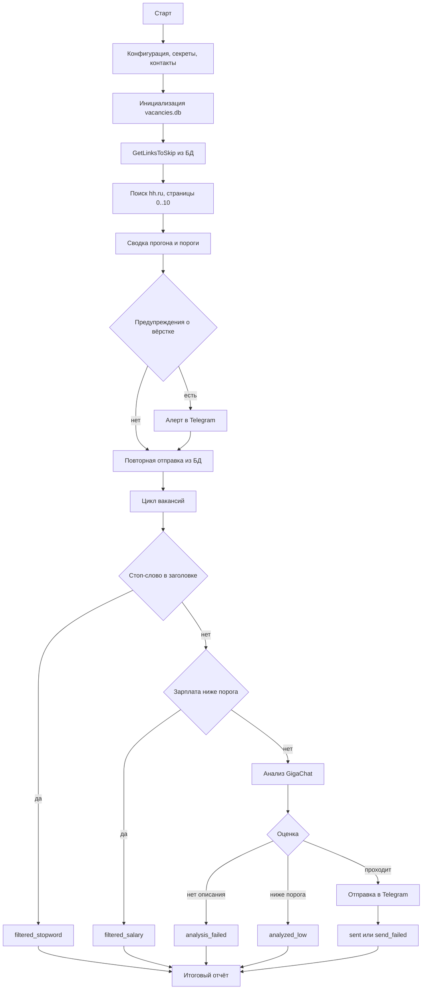
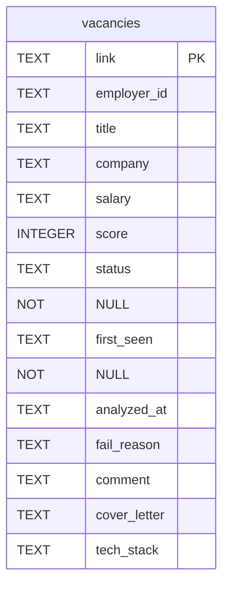

# Текущая архитектура

## Назначение

Этот документ описывает то, что код делает сейчас: поток одного прогона, модули,
статусы и схему БД. Расхождения с принятыми решениями собраны в отдельном
разделе
[«Известные расхождения с решениями»](#известные-расхождения-с-решениями).
Почему решено так — в [docs/adr/](adr/).

## Поток одного прогона

1. Старт; Ctrl+C: первый — остановка после текущей вакансии, второй — жёсткий
   выход — [Program.cs:82-96](../src/AiRecruiter/Program.cs#L82-L96).
2. Конфигурация: `appsettings.json` (optional) + переменные окружения —
   [Program.cs:100-104](../src/AiRecruiter/Program.cs#L100-L104).
3. Секреты `GIGACHAT_AUTH_KEY` / `TELEGRAM_BOT_TOKEN` / `TELEGRAM_CHAT_ID` —
   [Program.cs:106-164](../src/AiRecruiter/Program.cs#L106-L164).
4. Контакты `Contacts:Fio/Tg/Phone/Email` обязательны, иначе выход —
   [Program.cs:112-144](../src/AiRecruiter/Program.cs#L112-L144).
5. `resume.txt` / `profile.md` читаются, но в оценке не участвуют;
   `candidate_summary.md` — единственный источник, анализатор читает его сам —
   [JobAnalyzer.cs:98](../src/AiRecruiter/Analyzers/JobAnalyzer.cs#L98). При
   отсутствии сводки — пустая сводка.
6. `workFormat`: area `113` → REMOTE, area `4` → любой, иначе REMOTE —
   [Program.cs:176-188](../src/AiRecruiter/Program.cs#L176-L188).
7. Инициализация хранилища `vacancies.db` —
   [Program.cs:191-192](../src/AiRecruiter/Program.cs#L191-L192).
8. Порог `Analyzer:MinScore` (по умолчанию 3) —
   [Program.cs:194](../src/AiRecruiter/Program.cs#L194).
9. `GetLinksToSkip()` — уже обработанные ссылки из БД —
   [Program.cs:196](../src/AiRecruiter/Program.cs#L196).
10. Поиск hh.ru: страницы 0..10 —
    [Program.cs:198](../src/AiRecruiter/Program.cs#L198).
11. Сводка прогона парсера и лог —
    [Program.cs:202-203](../src/AiRecruiter/Program.cs#L202-L203).
12. Пороги `HhParser:Thresholds:*`, `Filters:MinSalary`,
    `Filters:ExcludeTitleWords` —
    [Program.cs:206-213](../src/AiRecruiter/Program.cs#L206-L213).
13. Предупреждения о вёрстке hh.ru —
    [Program.cs:217-265](../src/AiRecruiter/Program.cs#L217-L265).
14. Создание анализатора — [Program.cs:267](../src/AiRecruiter/Program.cs#L267).
15. Создание notifier — [Program.cs:269](../src/AiRecruiter/Program.cs#L269).
16. Алерт о смене вёрстки в Telegram, если есть предупреждения —
    [Program.cs:271-276](../src/AiRecruiter/Program.cs#L271-L276).
17. Повторная отправка из сохранённого результата — до цикла вакансий —
    [Program.cs:279](../src/AiRecruiter/Program.cs#L279).
18. Цикл вакансий —
    [Program.cs:286-432](../src/AiRecruiter/Program.cs#L286-L432):
    1. пропуск уже виденных —
       [Program.cs:294](../src/AiRecruiter/Program.cs#L294);
    2. фильтр по стоп-словам в заголовке —
       [Program.cs:302](../src/AiRecruiter/Program.cs#L302);
    3. фильтр по зарплате —
       [Program.cs:324-325](../src/AiRecruiter/Program.cs#L324-L325);
    4. анализ GigaChat — [Program.cs:349](../src/AiRecruiter/Program.cs#L349);
    5. без описания → `analysis_failed` —
       [Program.cs:351-369](../src/AiRecruiter/Program.cs#L351-L369);
    6. оценка ниже порога → `analyzed_low`, в Telegram не отправляется —
       [Program.cs:370-391](../src/AiRecruiter/Program.cs#L370-L391);
    7. `analyzed_ok` → отправка в Telegram → `sent` / `send_failed` —
       [Program.cs:392-422](../src/AiRecruiter/Program.cs#L392-L422); метка 🔥/💭
       — [Program.cs:412](../src/AiRecruiter/Program.cs#L412), запись статуса —
       [Program.cs:414](../src/AiRecruiter/Program.cs#L414).
19. Итог: отфильтровано по зарплате, распределение оценок, неудачи JSON —
    [Program.cs:434-446](../src/AiRecruiter/Program.cs#L434-L446).
20. Прогон ждёт Enter — [Program.cs:449](../src/AiRecruiter/Program.cs#L449).

## Модули

| Файл | Вход | Выход | Что пишет в БД |
|---|---|---|---|
| [Program.cs](../src/AiRecruiter/Program.cs) | конфигурация, секреты, контакты, входные файлы | запуск всех этапов, лог, итоговый отчёт | статусы всех вакансий: `seen`, `filtered_stopword`, `filtered_salary`, `analysis_failed`, `analyzed_low`, `analyzed_ok`, `sent`, `send_failed` |
| [HhParser.cs](../src/AiRecruiter/Parsers/HhParser.cs) | поисковый запрос, area, workFormat, skipLinks | список `Vacancy` + сводка прогона | нет |
| [JobAnalyzer.cs](../src/AiRecruiter/Analyzers/JobAnalyzer.cs) | вакансия, сводка кандидата, конфигурация GigaChat | `AnalysisResult` (score, comment, cover_letter) | нет |
| [TelegramNotifier.cs](../src/AiRecruiter/Notifiers/TelegramNotifier.cs) | вакансия, результат анализа, метка | сообщения Telegram | нет |
| [VacancyRepository.cs](../src/AiRecruiter/Storage/VacancyRepository.cs) | `VacancyRecord`, статусы | ссылки для пропуска, записи для повторной отправки, распределение оценок | запись и обновление строк `vacancies`, миграция колонок |
| [TitleFilter.cs](../src/AiRecruiter/Filters/TitleFilter.cs) | заголовок вакансии, стоп-слова | найденное стоп-слово или null | нет |
| [SalaryFilter.cs](../src/AiRecruiter/Filters/SalaryFilter.cs) | строка зарплаты, порог `Filters:MinSalary` | решение «пропустить» + нижняя граница | нет |
| [IntConfigReader.cs](../src/AiRecruiter/Configuration/IntConfigReader.cs) | конфигурация | целое число с значением по умолчанию | нет |
| [StringListConfigReader.cs](../src/AiRecruiter/Configuration/StringListConfigReader.cs) | конфигурация | список строк с значением по умолчанию | нет |
| [Logger.cs](../src/AiRecruiter/Logger.cs) | сообщения | `app.log` с ротацией 5 МБ | нет |
| [Vacancy.cs](../src/AiRecruiter/Models/Vacancy.cs) | — | поля вакансии, собранные парсером | нет |

## Диаграмма потока

## Статусы

| Статус | Где ставится | Что дальше |
|---|---|---|
| `seen` | legacy-строки старых версий; миграция удалена | попадает в `GetLinksToSkip`, не парсится заново |
| `filtered_stopword` | до GigaChat — [Program.cs:306-319](../src/AiRecruiter/Program.cs#L306-L319) | в `GetLinksToSkip`, не анализируется повторно |
| `filtered_salary` | до GigaChat — [Program.cs:328-341](../src/AiRecruiter/Program.cs#L328-L341) | в `GetLinksToSkip`, не анализируется повторно |
| `analysis_failed` | анализ без описания или провал — [Program.cs:354-367](../src/AiRecruiter/Program.cs#L354-L367) | не попадает в `GetLinksToSkip` — [VacancyRepository.cs:172-184](../src/AiRecruiter/Storage/VacancyRepository.cs#L172-L184), переанализируется при следующем появлении в выдаче |
| `analyzed_low` | оценка ниже порога — [Program.cs:374-387](../src/AiRecruiter/Program.cs#L374-L387) | в `GetLinksToSkip`, в Telegram не отправляется |
| `analyzed_ok` | оценка не ниже порога — [Program.cs:395-408](../src/AiRecruiter/Program.cs#L395-L408) | живёт только между `Upsert` и `SetStatus` в одной итерации цикла |
| `sent` / `send_failed` | результат отправки — [Program.cs:414](../src/AiRecruiter/Program.cs#L414) | обе попадают в повторную отправку из сохранённого результата — [VacancyRepository.cs:190-218](../src/AiRecruiter/Storage/VacancyRepository.cs#L190-L218) |

## Схема БД

Схема создаётся —
[VacancyRepository.cs:51-67](../src/AiRecruiter/Storage/VacancyRepository.cs#L51-L67),
отсутствующие колонки добавляются миграцией —
[VacancyRepository.cs:77-92](../src/AiRecruiter/Storage/VacancyRepository.cs#L77-L92).

## Поля

| Поле | Тип | Смысл | Источник в коде |
|---|---|---|---|
| `employer_id` | TEXT NULL | идентификатор работодателя | всегда null — [Program.cs:308](../src/AiRecruiter/Program.cs#L308) |
| `score` | INTEGER NULL | оценка GigaChat 1..10 | [JobAnalyzer.cs:1004](../src/AiRecruiter/Analyzers/JobAnalyzer.cs#L1004) |
| `first_seen` | TEXT NOT NULL | время первой записи в БД | [Program.cs:300](../src/AiRecruiter/Program.cs#L300) |
| `analyzed_at` | TEXT NULL | время анализа или отправки | [Program.cs:363](../src/AiRecruiter/Program.cs#L363), [Program.cs:383](../src/AiRecruiter/Program.cs#L383), [Program.cs:404](../src/AiRecruiter/Program.cs#L404), [VacancyRepository.cs:140-142](../src/AiRecruiter/Storage/VacancyRepository.cs#L140-L142) |
| `tech_stack` | TEXT NULL | стек из описания вакансии | [HhParser.cs:664](../src/AiRecruiter/Parsers/HhParser.cs#L664) |

## Известные расхождения с решениями

- `employer_id` всегда null —
  [Program.cs:308](../src/AiRecruiter/Program.cs#L308),
  [Program.cs:330](../src/AiRecruiter/Program.cs#L330),
  [Program.cs:356](../src/AiRecruiter/Program.cs#L356),
  [Program.cs:376](../src/AiRecruiter/Program.cs#L376),
  [Program.cs:397](../src/AiRecruiter/Program.cs#L397); решение 0002 —
  [employer_id из детальной страницы](adr/0002-employer-id-from-detail-page.md)
  — не реализовано.
- `analysis_abandoned` отсутствует; статусы — строковые литералы, не константы —
  [Program.cs:313](../src/AiRecruiter/Program.cs#L313),
  [Program.cs:335](../src/AiRecruiter/Program.cs#L335),
  [Program.cs:361](../src/AiRecruiter/Program.cs#L361),
  [Program.cs:381](../src/AiRecruiter/Program.cs#L381),
  [Program.cs:402](../src/AiRecruiter/Program.cs#L402),
  [Program.cs:414](../src/AiRecruiter/Program.cs#L414); исправление —
  [roadmap 3.2a, шаг 6](roadmap.md).
- Журнала `llm_calls`, таблиц `prompt_versions` и `candidate_profiles` в БД нет
  — не реализовано; исправление — [roadmap 3.2a, шаг 7](roadmap.md).
- `GetScoreDistribution` —
  [VacancyRepository.cs:158](../src/AiRecruiter/Storage/VacancyRepository.cs#L158)
  — вызывается только из тестов; гистограмма в итоговом отчёте считается в
  памяти — [Program.cs:282](../src/AiRecruiter/Program.cs#L282),
  [Program.cs:439](../src/AiRecruiter/Program.cs#L439); исправление —
  технический бэклог после 3.6 в [roadmap](roadmap.md).
- [Program.cs:148](../src/AiRecruiter/Program.cs#L148) читает
  `candidate_summary.md` в неиспользуемую переменную; анализатор читает файл сам
  — [JobAnalyzer.cs:98](../src/AiRecruiter/Analyzers/JobAnalyzer.cs#L98);
  исправление — [roadmap 3.2a, шаг 5](roadmap.md).
- В БД нет `experience` / `employment` / `work_format` / `published_at`, хотя
  `Vacancy` их содержит — [Vacancy.cs](../src/AiRecruiter/Models/Vacancy.cs);
  исправление — [roadmap 3.2a, шаг 4](roadmap.md).
- Telegram не разбивает сообщения длиннее 4096 —
  [TelegramNotifier.cs:78-99](../src/AiRecruiter/Notifiers/TelegramNotifier.cs#L78-L99);
  исправление — [roadmap 3.2a, шаг 8](roadmap.md).
- `usage` / `completion_tokens` не читаются, критерий пересмотра `MaxTokens`
  ([ADR-0004](adr/0004-max-tokens-1200.md)) не измеряется; код-дефолт — 800 —
  [JobAnalyzer.cs:102](../src/AiRecruiter/Analyzers/JobAnalyzer.cs#L102);
  исправление — калибровка 3.2 в [roadmap](roadmap.md).
- Контакты `Contacts:Fio/Tg/Phone/Email` читаются и проверяются на старте —
  [Program.cs:112-144](../src/AiRecruiter/Program.cs#L112-L144) — и собираются
  строкой — [Program.cs:144](../src/AiRecruiter/Program.cs#L144), но в промпт не
  попадают: поле только присваивается —
  [JobAnalyzer.cs:97](../src/AiRecruiter/Analyzers/JobAnalyzer.cs#L97). В анализ
  не входят; исправление — [roadmap 3.3](roadmap.md)
  ([ADR-0011](adr/0011-contacts-in-cover-letter.md)).

## Правило обновления

- При изменении потока, схемы БД, статусов или модулей обновить этот документ в
  том же коммите и перепроверить все ссылки на строки.
- Новое архитектурное решение — новый ADR в [docs/adr/](adr/).
- Обязательное правило и чеклист перед коммитом — в разделе
  [«Документация»](../AGENTS.md#документация) файла [AGENTS.md](../AGENTS.md).
